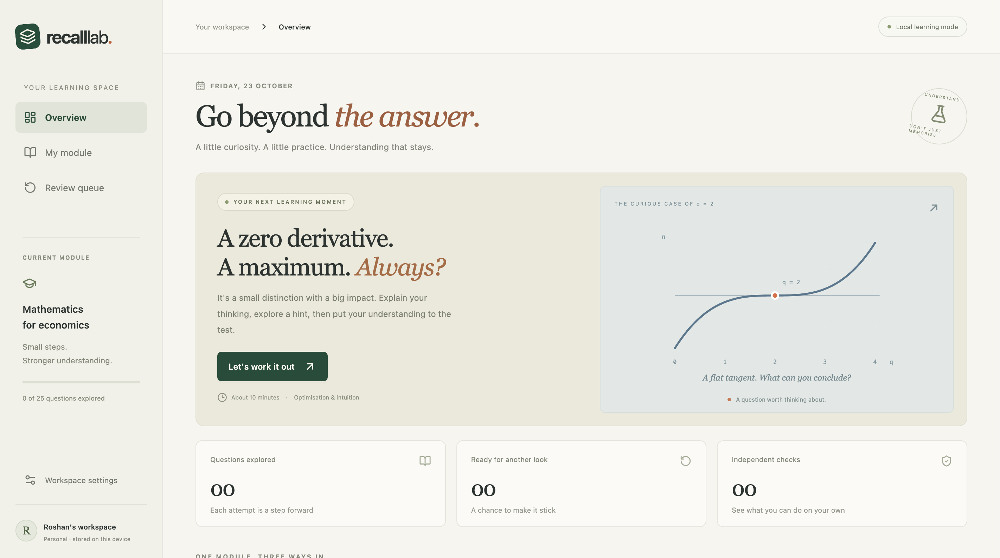

# RecallLab

**Explain it. Practise it. Prove you understand it.**

RecallLab is a local, single-learner study companion for mathematics for economics. Start with a genuine attempt, use reviewed hints if needed, and check understanding on five separate assessment questions.

## What works

- React/TypeScript dashboard, three learning paths, 12 concepts, 25 practice questions and five separate check questions.
- Safe symbolic grading of numbers and a bounded polynomial grammar; no evaluation of Python supplied by learners.
- Graduated hints, original source notes, explicit solution reveal and assisted-attempt tracking.
- SQLite sessions, idempotent submissions, resume after restarting, and a suggested next-day review queue.
- A real MCP Streamable HTTP server with four tools, called by the browser's official MCP TypeScript client.
- Optional Amazon Bedrock Nova Lite assessment of conceptual explanations, with validated rubric results, reviewed misconception IDs and authored feedback.
- Keyboard navigation, accessible labels, editable optional speech input, read-aloud, responsive layouts and reduced-motion support.

**Cloud calls are OFF by default.** Mathematical checking and authored learning material work without an AWS account. In local mode conceptual explanations are explicitly marked ungraded and saved for self-review. This is not a simulated successful model response.



## Run locally

Requires Python 3.11+ and Node.js 22.12+ (Node 24 recommended).

```sh
python3 -m venv .venv
.venv/bin/python -m pip install -r backend/requirements.lock.txt
npm --prefix frontend ci
npm --prefix frontend run build
./run.sh
```

Open **http://127.0.0.1:8000/**. The server binds to loopback. The launcher must run from a terminal whose `node` and `npm` resolve to the supported version. On this workspace Node 24 is installed under `~/.nvm/versions/node/v24.13.0/bin`.

For frontend development, run the backend and then `npm --prefix frontend run dev`. Vite proxies `/api` and `/mcp` to port 8000. Build and restart the backend before testing a changed production build if its static directory did not exist at startup.

## Tests

```sh
.venv/bin/python -m pip install -r backend/requirements-dev.txt
PYTHONPATH=backend .venv/bin/python -m pytest backend/tests -q
```

Candidate conceptual benchmark (no model calls by default):

```sh
PYTHONPATH=backend .venv/bin/python backend/evaluate.py
```

After explicit cloud enablement, `--live --limit 1` performs one real evaluation; `--live` runs up to 60. Labels still require independent educator review.

Run all local release checks with `.venv/bin/python scripts/verify_release.py` (with supported Node on PATH). This checks dependencies, tests, production build, production dependency audit, offline evaluation inventory and the source package. It never enables cloud assessment.

See [delivery checklist](docs/PLAN.md), [submission copy](docs/SUBMISSION.md), [product feedback](docs/PRODUCT_FEEDBACK.md), [pilot kit](docs/PILOT.md), [validation](docs/VALIDATION.md), [architecture](docs/ARCHITECTURE.md), [AWS setup](docs/AWS_SETUP.md) and the [demo script](docs/DEMO.md).

## Enable actual Bedrock assessment

First verify model/region access and credits or an approved budget. This repository does not register accounts, request payment details, or enable a paid plan.

Authenticate using the standard AWS credential provider chain (prefer a short-lived AWS profile). Then launch explicitly:

```sh
AWS_PROFILE=recalllab \
AWS_REGION=us-east-1 \
RECALLLAB_MODEL_ID=amazon.nova-lite-v1:0 \
RECALLLAB_ENABLE_BEDROCK=1 \
./run.sh
```

The model and region above are defaults, not a claim of availability for a particular account. The daily assessment cap defaults to 100 total attempts and can be reduced with `RECALLLAB_DAILY_ATTEMPT_LIMIT`. Conceptual requests have bounded input (3,000 learner characters), output (180 tokens), a timeout and no SDK retry. AWS billing budgets are alerts, not universal spending stops. A local cap is not a replacement for account billing controls.

`.env.example` documents settings; **the launcher does not automatically source an `.env` file**. Keep credentials out of source files and browser storage.

## Data and scope

Runtime data lives in ignored `data/recalllab.sqlite3`. Back it up while the application is stopped. The local application assumes one learner; session IDs are not an authentication system. Do not expose it publicly as a multi-user service. A public deployment needs identity, per-user authorization, TLS, migrations and deployment-specific origin controls.

The repository contains original teaching content only; no private course PDFs or email/account data. Browser speech recognition may use the browser provider's online service; it is optional and never auto-submits an answer.

The browser experience demonstrates an Alexa+ use case. It is not an official Alexa simulator or native Alexa+ integration. Learning gains and conceptual-model accuracy are not yet validated with students. Assistance counts record opened hints and solution reveals; opening a source note is not included in that counter. The independent questions are distinct from practice questions but repeat across check sessions; repeated-check scores are not a blinded learning study.

## Licence

MIT for the application and original course content. Third-party dependencies retain their respective licences.
