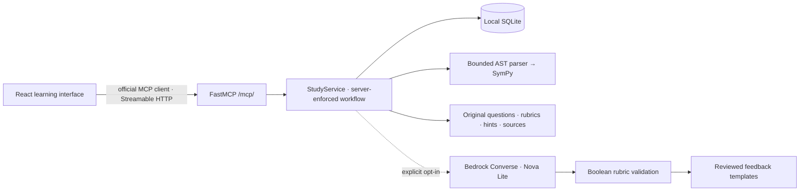

# Architecture

## Interfaces

- `GET /api/module`: public concept/path metadata; no keys or rubrics.
- `GET /api/health`: local model mode and service health, never credentials.
- `/mcp/`: official MCP Streamable HTTP implementation, with `start_session`, `submit_attempt`, `review_question` and `get_progress`.
- `start_session(module_id, mode, resume_id?, track)`: creates or resumes an application session. Application sessions persist independently from transport sessions.
- `submit_attempt(study_session_id, question_id, request_id, answer)`: verifies current question, stores one assessment per request ID, rejects reuse with another payload.
- `review_question(study_session_id, question_id, action)`: an attempt must precede hint/solution/advance; practice assistance is persisted. Independent checks allow only advance until completion.
- `get_progress(module_id)`: practice history, pending/completed sessions, independent results, suggested review dates. No marks from unfinished checks.

## Assessment

Numeric and polynomial expressions are parsed with Python AST node allowlists and assembled directly as SymPy objects. Input length, number size, exponent, degree and depth are limited. Calls, attributes, indexing and symbolic denominators are rejected. Neither `eval`, `sympify` nor `parse_expr` accepts learner input.

Bedrock receives a hidden rubric, question and untrusted student explanation. Only a correctly shaped object with boolean `assessable` and a boolean array matching the rubric length and allowlisted misconception IDs is accepted. Repeated, unknown or contradictory diagnostics are rejected. Returned criterion IDs and diagnostic feedback are derived from reviewed content. Token usage returned by the provider is preserved even when assessment JSON is rejected. No free-form model feedback, invented citation or solution is rendered. Failed, malformed or unavailable assessments abstain; they do not claim correctness. The versioned course notes provide the source text.

`BEGIN IMMEDIATE` serializes updates so concurrent duplicate submissions perform one model request and save one attempt. A failed assessment remains saved under its request ID; a deliberate new attempt requires a new ID. This avoids retry-driven spending.

## Boundaries

Localhost binding, host/origin checks, a restrictive CSP, payload size limits and server-side AWS credentials protect the local prototype. There is no shell tool, arbitrary code tool, agent swarm, cloud deployment, account automation script or payment form. The MCP tools are directly invoked by the UI; this is not an autonomous agent planner. Course retrieval is explicit question-to-source mapping, not vector search. These are deliberate v1 boundaries.
